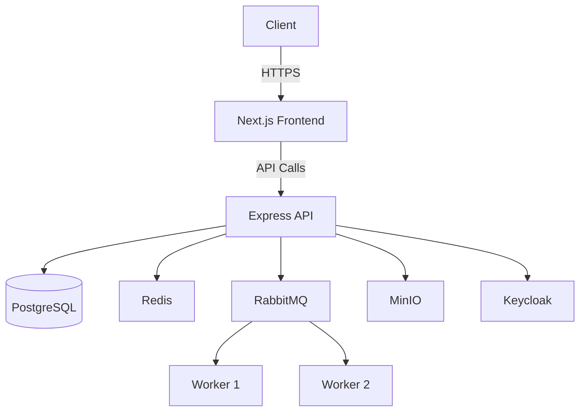

<div align="center">
  
  
  # Resolve360 – Enterprise Support Ticket System
  
  [](https://opensource.org/licenses/MIT)
  [](https://nodejs.org/)
  [](https://nextjs.org/)
  [](https://www.typescriptlang.org/)
  [](https://www.postgresql.org/)
  [](https://www.docker.com/)
  [](https://github.com/yourusername/resolve360/actions)
  [](https://codecov.io/gh/yourusername/resolve360)
  
  A modern, scalable support ticket system with multi-tenant architecture, real-time updates, and comprehensive role-based access control.
  [Documentation](https://docs.resolve360.example.com) | [API Reference](https://api.resolve360.example.com) | [Contributing](CONTRIBUTING.md)
</div>

### Resolve360 – Multi‑Tenant Support Ticket System

Resolve360 is a multi‑tenant support portal where organizations manage customer tickets end‑to‑end. It provides role‑based dashboards for Org Admins, Agents, and Customers; ticket lifecycle management; comments; attachments; and real‑time updates.

Key links
- Overview and deep‑dives: see [ABOUT_PROJECT/README.md](ABOUT_PROJECT/README.md)
- Frontend: `client/` (Next.js)
- Backend: `server/` (Express + PostgreSQL + Redis + RabbitMQ + MinIO)

## 🌟 Key Features

### 🏢 Multi-Tenant Architecture
- **Isolated Tenants**: Complete data separation between organizations
- **Custom Branding**: Per-tenant theming and customization
- **Resource Quotas**: Control over storage and API usage per tenant

### 🎯 Core Functionality
- **Ticket Management**
  - Custom ticket types and workflows
  - Priority and SLA management
  - Advanced filtering and search
  - Bulk actions
- **Knowledge Base**
  - Public and internal articles
  - Version history
  - Content categorization

### 🔐 Security & Access Control
- **Role-Based Access Control**
  - Organization Admin
  - Support Agent
  - End User
  - Custom roles
- **Authentication**
  - Multi-factor authentication
  - SSO with Keycloak
  - Social logins

### 🚀 Performance & Scalability
- **Real-time Updates**
  - WebSocket-based notifications
  - Live chat support
  - Activity streams
- **Background Processing**
  - Email notifications
  - Report generation
  - Data exports

### 🛠 Developer Experience
- **API-First Design**
  - RESTful API with OpenAPI documentation
  - Webhook support
  - API rate limiting
- **Developer Tools**
  - Comprehensive test suite
  - CI/CD pipelines
  - Containerized development environment

## 🏗 System Architecture

### High-Level Overview


### Data Flow
1. **Frontend Layer**: Next.js application with server-side rendering
2. **API Layer**: Stateless Express.js API services
3. **Data Layer**: PostgreSQL for relational data
4. **Caching**: Redis for session management and caching
5. **Message Queue**: RabbitMQ for background job processing
6. **Storage**: MinIO for file storage and retrieval
7. **Auth**: Keycloak for identity and access management

## 🚀 Getting Started

### 📋 Prerequisites

- **Node.js** 16+ (LTS recommended)
- **Docker** 20.10+ and **Docker Compose** 2.0+
- **pnpm** 7.x (recommended) or **npm** 8.x+
- **Git** 2.25+

### 🛠 Installation

#### 1. Clone the Repository
```bash
git clone https://github.com/yourusername/resolve360.git
cd resolve360
```

#### 2. Environment Setup
1. Copy the example environment file:
   ```bash
   cp .env.example .env
   ```
2. Update the environment variables in `.env` as needed.

#### 3. Start Development Environment

**Option A: Using Docker Compose (Recommended)**
```bash
# Start all services
docker-compose -f docker/docker-compose.dev.yml up -d

# Install dependencies
pnpm install

# Run database migrations
pnpm db:migrate

# Start development servers
pnpm dev
```

**Option B: Local Development**
```bash
# Install dependencies
pnpm install

# Start required services (PostgreSQL, Redis, etc.)
docker-compose -f docker/docker-compose.dev.yml up -d db redis

# Run database migrations
pnpm db:migrate

# Start development servers
pnpm dev
```

### 🔍 Accessing Services

| Service | URL | Credentials |
|---------|-----|-------------|
| Frontend | http://localhost:3000 | - |
| API Server | http://localhost:5000 | - |
| API Docs | http://localhost:5000/api-docs | - |
| Keycloak Admin | http://localhost:8080/admin | `admin:admin` |
| MinIO Console | http://localhost:9001 | `minioadmin:minioadmin` |
| PostgreSQL | localhost:5432 | `postgres:postgres` |
| Redis Commander | http://localhost:8081 | - |

### 🧪 Running Tests

```bash
# Run all tests
pnpm test

# Run unit tests
pnpm test:unit

# Run integration tests
pnpm test:integration

# Run e2e tests
pnpm test:e2e
```

### 🏗 Building for Production

```bash
# Build the application
pnpm build

# Start production server
pnpm start
```

### 🐳 Docker Production Build

```bash
# Build and start production containers
docker-compose -f docker-compose.prod.yml up -d --build
```

Repository structure
```
caredesk/
  client/            # Next.js app (UI)
  server/            # Express API, Socket.IO, routes
  docker/            # Compose for Postgres, Redis, RabbitMQ, MinIO, Mongo (dev)
  ABOUT_PROJECT/     # Architecture and technology docs
  README.md
```

Default ports
- Client: http://localhost:3000
- API: http://localhost:5000
- MinIO console: http://localhost:9001 (minioadmin/minioadmin)
- Keycloak: http://localhost:8080 (if enabled locally)

Documentation
- Start at [ABOUT_PROJECT/README.md](ABOUT_PROJECT/README.md) for detailed explanations.
- Frontend details: [ABOUT_PROJECT/Nextjs.md](ABOUT_PROJECT/Nextjs.md)
- Authentication and roles: [ABOUT_PROJECT/Keycloak.md](ABOUT_PROJECT/Keycloak.md)
- Database (PostgreSQL): [ABOUT_PROJECT/PostgreSQL.md](ABOUT_PROJECT/PostgreSQL.md)
- Redis queues: [ABOUT_PROJECT/Redis.md](ABOUT_PROJECT/Redis.md)
- RabbitMQ workers: [ABOUT_PROJECT/RabbitMQ.md](ABOUT_PROJECT/RabbitMQ.md)
- MinIO attachments: [ABOUT_PROJECT/MinIO.md](ABOUT_PROJECT/MinIO.md)
- Architecture overview: [ABOUT_PROJECT/Architecture.md](ABOUT_PROJECT/Architecture.md)
- System design & scaling: [ABOUT_PROJECT/System-Design.md](ABOUT_PROJECT/System-Design.md)

